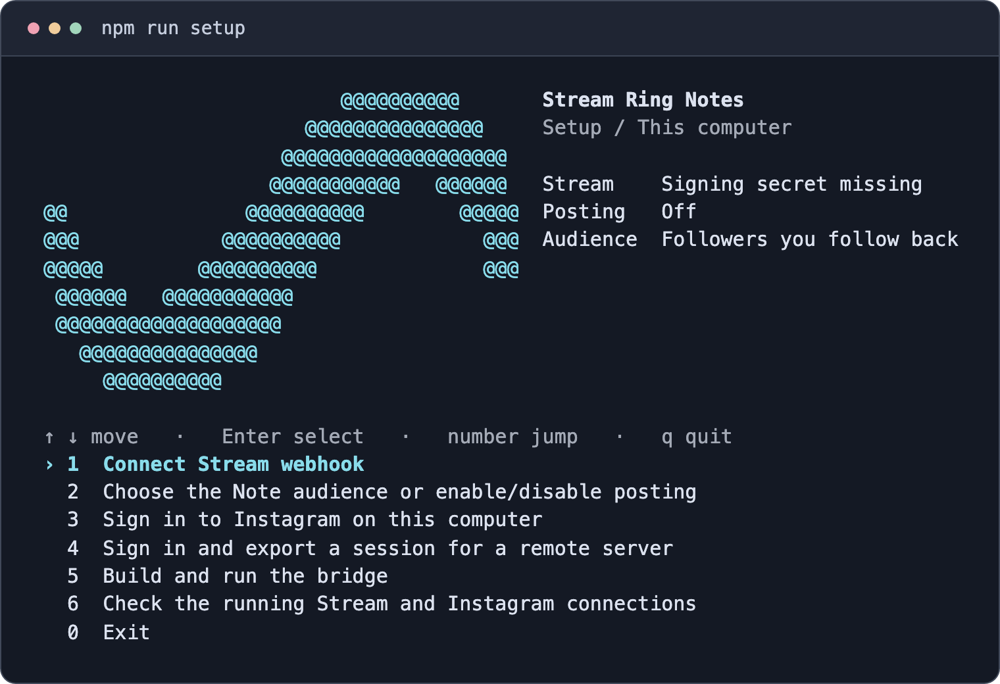

# Stream Ring Notes

[](https://github.com/jerryj6/stream-ring-notes/actions/workflows/ci.yml)
[](LICENSE)

Post an Instagram Note by speaking into your [Sandbar Stream Ring](https://www.sandbar.com/). This self-hosted bridge reads signed Stream webhooks and uses your signed-in Instagram browser session to post or clear your Note.

[Quick start](#quick-start) · [Docker and VPS](docs/deploy.md#docker-compose-on-a-server-or-vps) · [Remote sign-in](#sign-in-for-a-remote-server) · [Troubleshooting](docs/deploy.md#if-a-check-fails)



## Voice commands

| Say this into your Ring | What happens |
| --- | --- |
| “Instagram note: at the library” | Posts **at the library** as your Note. |
| “Instagram note: back after lunch” | Replaces your current Note with **back after lunch**. |
| “Instagram note clear” | Removes your current Note. |
| “Pick up coffee on the way home” | The bridge discards the capture. |

By default your Note is visible to followers you follow back. Set `DEFAULT_AUDIENCE=1` for Close Friends. The bridge shortens text to fit Instagram’s 60 UTF-16 unit limit without splitting emoji or other graphemes.

## Quick start

You’ll need a Stream Ring paired with the Stream iOS app, access to **Developer (Webhook)** in Stream, an Instagram account you can sign in to, and an HTTPS URL the app can reach. You can use [Tailscale Funnel or your own domain with Caddy](docs/deploy.md#https-for-stream).

Clone the repo on the computer where you'll sign in, and on the server if you plan to host it remotely.

```sh
git clone https://github.com/jerryj6/stream-ring-notes.git
cd stream-ring-notes
```

| Where it runs | What you’ll need | Setup |
| --- | --- | --- |
| VPS or home server | Docker Compose v2 on the server. Node.js 22 or 24 on your laptop or desktop for sign-in. | [Docker Compose walkthrough](docs/deploy.md#docker-compose-on-a-server-or-vps) |
| Your everyday computer | Node.js 22 or 24 and a graphical desktop. The bridge runs while your computer is awake. | [Local quick start](#run-on-your-computer) |
| Linux server with systemd | Node.js 22 or 24 on the server and on your laptop or desktop for sign-in. | [Native server and systemd setup](docs/deploy.md#native-headless-server) |

### Run on your computer

Open a terminal in the repository and run:

```sh
npm ci
npm run setup
```

Choose **Sign in to Instagram on this computer**. Setup installs Chromium and opens Instagram for you to sign in. Complete any two-factor or approval prompts in that window. Back in the menu, choose **Build and run the bridge**. [Expose port 8779 over HTTPS](docs/deploy.md#https-for-stream), then [pair Stream](#pair-stream-and-send-a-note).

Use **↑ / ↓** and **Enter** to select an action. A number jumps to that action, and **q** exits. The header shows your Stream, posting, and audience settings. The signing prompt hides what you paste. Set `NO_COLOR=1` for plain terminal output.

For automation, `npm run setup -- --init` only creates `.env` if it is missing. The individual `login`, `build`, `start`, and `status` commands also work on their own.

### Sign in for a remote server

**Sign in on your laptop or desktop. Import the session on the server over SSH.** The headless server runs Chromium after setup, so you can close your laptop once everything is configured.

1. **On the server**, build the image using the [Docker setup commands](docs/deploy.md#build-on-the-server). Keep the bridge stopped while importing a session.
2. **In a local terminal on your laptop or desktop**, open a copy of this repository and run:

   ```sh
   npm ci
   npm run setup
   ```

   Choose **Sign in and export a session for a remote server**. Sign in in the Chromium window that opens on your computer and wait for the wizard to create `data/storageState.json` locally.

3. **From that same local terminal**, exit the setup menu and send the session to the Docker server. Replace `user@your-server` and `~/stream-ring-notes` with your SSH login and repository path.

   ```sh
   ssh -T user@your-server 'cd ~/stream-ring-notes &&
     docker compose -f deploy/docker-compose.yml stop instagram-notes &&
     docker compose -f deploy/docker-compose.yml run --rm -T instagram-notes npm run import-session -- -' \
     < data/storageState.json
   ```

   The shell reads the file on your computer. SSH streams the cookies into the import command on the server, where Chromium saves the session in the Docker volume. The export grants access to your Instagram session, so keep it private and delete it after a successful import with `rm data/storageState.json`. For a server without Docker, use the [native SSH import command](docs/deploy.md#native-headless-server).

4. **On the server**, [set up HTTPS and start the container](docs/deploy.md#give-stream-an-https-url), then [verify the webhook and the imported Instagram session](docs/deploy.md#verify-and-enable-posting). If Instagram challenges the session after the move, review the login in Instagram before trying another import.

## Pair Stream and send a Note

Leave posting disabled while you test the connection.

1. On your iPhone, open **Stream → Settings → Other Tools → Developer (Webhook)**. Enter the exact HTTPS URL ending in `/stream/ig` and turn on **Sign requests**. On the host, choose **Connect Stream webhook** in the setup menu and paste the full `swh_` secret. Restart the native service or recreate the container.
2. Run the checks below from the repository. Expect `HTTP 204` from the signed probe and `"status": "ready"` from the read-only inbox check. For Docker, use the [container commands](docs/deploy.md#verify-and-enable-posting).

   ```sh
   npm run check-stream -- https://your-host.example/stream/ig
   npm run status -- --check-instagram
   ```

3. If the checks pass and you accept the [account risk](#account-risk), set `ENABLE_PRIVATE_API=true` in `.env` and restart the service or recreate the container. Turn on **Send interactions** in Stream, then say **“Instagram note: at the library”** into your Ring. Look for the Note in Instagram or run `npm run status` to see the latest command outcome.

Stream sends saved Capture and Chat interactions. Universal Dictation and Stream replies are excluded. Chat can be off for silent captures. Use the exact webhook URL because Stream doesn’t follow redirects. [Sandbar’s Stream Webhook guide](https://support.sandbar.com/hc/en-us/articles/55372315664404-Set-up-Stream-Webhook)

## Configuration

| Setting in `.env` | Purpose |
| --- | --- |
| `STREAM_WEBHOOK_SECRET` | Verifies signed captures. Copy the full secret from Stream. |
| `ENABLE_PRIVATE_API` | Enables posting and clearing when set to `true`. Defaults to `false`. |
| `DEFAULT_AUDIENCE` | `0` for followers you follow back, `1` for Close Friends. |
| `API_KEY` | Authenticates local status checks. Setup generates this key. |

## Account risk

**Automatic posting is experimental.** The bridge uses a private Instagram web API through a signed-in browser. Instagram can challenge, restrict, or suspend accounts, and changes to its web app can break posting. The bridge requires opt-in and pauses on detected login challenges, rate limits, invalid TLS certificates, and unconfirmed mutations. A replacement deletes the old Note before creating the new one, so a failed replacement can leave your account without a Note. [Meta’s Instagram API documentation](https://www.postman.com/meta/instagram/documentation/6yqw8pt/instagram-api) · [Instagram’s Terms of Use](https://www.instagram.com/legal/terms/)

## Privacy and delivery

- Stream sends every saved interaction to your configured endpoint. The bridge verifies the signature and discards unrelated captures without storing, logging, or forwarding them. Keep request bodies out of proxy logs.
- The browser profile holds your Instagram session. Run the bridge on a host you trust and keep the operator port private.
- A matching command gets `202` when accepted. The service keeps the latest outcome and recent deduplication hashes in memory. It processes one command at a time and does not retry failed mutations. Check the result with `npm run status`.

## Development

Run `npm ci`, `npm run build`, and `npm test`. The tests simulate Instagram operations. For setup and connection errors, see the [troubleshooting guide](docs/deploy.md#if-a-check-fails).

[MIT license](LICENSE)
