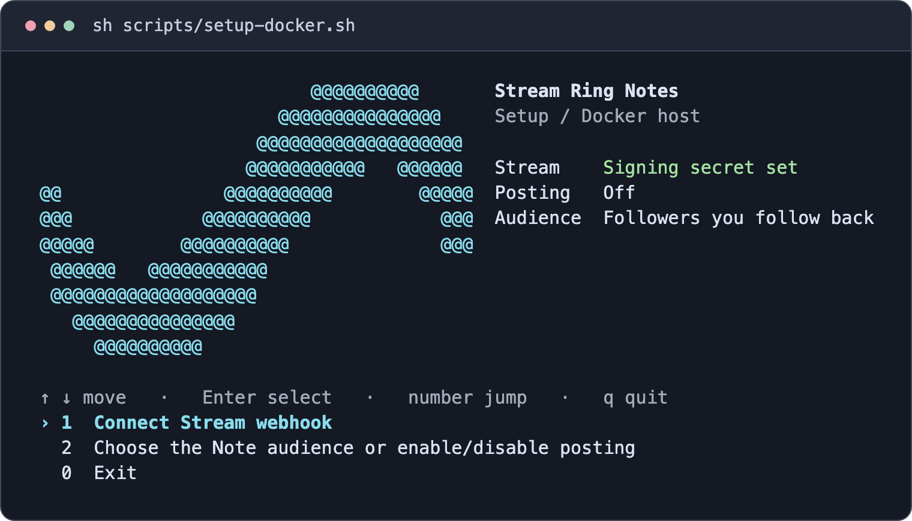

# Deploy Stream Ring Notes

Docker Compose is the easiest way to leave the bridge running on a server. You sign in to Instagram once on a desktop, import the session into the container, then point Stream at an HTTPS URL. The server needs Docker with Compose v2. Your desktop needs Node.js 22 or 24 and a graphical session. Use separate installations and browser profiles for each Instagram account.

## Docker Compose on a server or VPS

Have a copy of the repository on both the desktop and the server. The Docker examples use `~/stream-ring-notes` on the server and `user@your-server` as your SSH destination. Replace those with your own values.

### Build on the server

```sh
cd ~/stream-ring-notes
sh scripts/setup-docker.sh
docker compose -f deploy/docker-compose.yml build
```

The setup menu creates `.env` and generates an operator key. You can exit the menu and return after you have the signing secret from Stream. On a scripted install, `sh scripts/setup-docker.sh --init` just initializes the file. The bridge image includes Node and Chromium, and the container keeps the Instagram profile in a Docker volume. It runs as a non-root user with dropped capabilities and no new privileges. Chromium's inner sandbox is disabled for Docker's default seccomp policy.



### Sign in on your desktop and import

Open a terminal on the computer with a screen and follow the [remote sign-in steps in the README](../README.md#sign-in-for-a-remote-server). They show how to export a session locally and pipe it into the container over SSH.

If Docker is running on that same computer, run the import locally from the repository root after exporting the session:

```sh
docker compose -f deploy/docker-compose.yml stop instagram-notes
docker compose -f deploy/docker-compose.yml run --rm -T instagram-notes npm run import-session -- - \
  < data/storageState.json
```

Delete the export with `rm data/storageState.json` once the import succeeds.

### Give Stream an HTTPS URL

Choose [Tailscale Funnel or Caddy](#https-for-stream). Both forward to the same loopback port on the Docker host. Leave **Send interactions** off while you connect the account.

1. In the Stream iOS app, open **Settings → Other Tools → Developer (Webhook)** and enter the exact HTTPS URL ending in `/stream/ig`.
2. Turn on **Sign requests**. On the server, run `sh scripts/setup-docker.sh`, select **Connect Stream webhook**, and paste the full `swh_` secret.
3. Leave `ENABLE_PRIVATE_API=false` for the initial checks. Start the container on the server.

```sh
docker compose -f deploy/docker-compose.yml up -d --wait
```

### Verify and enable posting

Run both checks from the server, substituting your actual webhook URL. A successful signed probe returns `HTTP 204`. A successful inbox check prints `{"status":"ready"}`.

```sh
docker compose -f deploy/docker-compose.yml exec -T instagram-notes \
  npm run check-stream -- https://your-host.example/stream/ig
docker compose -f deploy/docker-compose.yml exec -T instagram-notes \
  npm run status -- --check-instagram
```

If both pass and you accept the [Instagram account risk](../README.md#account-risk), open the setup menu again, choose the posting settings, and type `ENABLE`. Recreate the container so it reads the updated file.

```sh
docker compose -f deploy/docker-compose.yml up -d --wait --force-recreate
```

Turn on **Send interactions** in Stream, then use the Ring to say “Instagram note: at the library.” Check Instagram or run the following on the server to see the last command outcome.

```sh
docker compose -f deploy/docker-compose.yml exec -T instagram-notes npm run status
```

## Native headless server

Create the export on your desktop using [step 2 of the remote sign-in guide](../README.md#sign-in-for-a-remote-server). On the server, with Node.js 22 or 24 installed, run:

```sh
npm ci
npm run setup -- --init
npx playwright install --with-deps chromium
npm run build
```

With the service stopped, run this from a local terminal on your desktop. Replace the path and SSH destination with yours. Make sure `npm` is on the server's PATH for non-interactive SSH commands.

```sh
ssh -T user@your-server 'cd ~/instagram-notes && npm run import-session -- -' < data/storageState.json
```

Delete the local export after a successful import. Run `npm start` on the server or install the systemd unit below, then follow the [Ring pairing steps](../README.md#pair-stream-and-send-a-note).

On Ubuntu 24.04, AppArmor can prevent Playwright’s downloaded browser from creating its sandbox even after the required libraries are installed. If this happens, install the official Google Chrome package and set `IG_CHROME_CHANNEL=chrome` in `.env` before importing. Keep `IG_CHROMIUM_SANDBOX=true` for a native install. [Ubuntu's user namespace notes](https://documentation.ubuntu.com/release-notes/24.04/#unprivileged-user-namespace-restrictions), [Google Chrome installation](https://support.google.com/chrome/answer/95346).

## Linux user systemd

Clone or copy the repository to `~/instagram-notes` and follow the native server setup. Install Node in the system PATH used by systemd, or set an absolute path to your Node executable in `ExecStart`.

```sh
mkdir -p ~/.config/systemd/user
install -m 644 deploy/instagram-notes.service ~/.config/systemd/user/
systemctl --user daemon-reload
systemctl --user enable --now instagram-notes
systemctl --user status instagram-notes
```

Use `loginctl enable-linger "$USER"` if you want the user service to start at boot before login and your host permits it. Restart the service after changing configuration. Use `systemctl --user disable --now instagram-notes` to stop it and remove autostart.

## HTTPS for Stream

Route only the Stream listener through your HTTPS gateway. For a VPS with a public IP and a domain, point a DNS record at the server, allow inbound TCP ports 80 and 443, and add this site block to the host's Caddyfile. Replace `notes.example.com` with your domain and reload Caddy. The webhook URL for this example is `https://notes.example.com/stream/ig`. [Caddy HTTPS setup](https://caddyserver.com/docs/quick-starts/https)

```caddyfile
notes.example.com {
    @stream {
        method POST
        path /stream/ig
    }
    reverse_proxy @stream 127.0.0.1:8779
    respond 404
}
```

For a home server or a host without a public domain, install Tailscale, sign in on the host, and enable Funnel for it. Run this if port 10000 is free:

```sh
tailscale funnel --bg --https=10000 8779
tailscale funnel status
```

Use the HTTPS base URL that Funnel reports, followed by `/stream/ig`. Include `:10000` if shown. Funnel makes this listener public so the iPhone can send a capture from outside your tailnet. Disable this specific listener with `tailscale funnel --https=10000 off`. [Tailscale Funnel CLI](https://tailscale.com/docs/reference/tailscale-cli/funnel)

Keep operator port 4317 private. Keep the host clock synchronized and leave request bodies out of proxy logs.

## If a check fails

- If the webhook probe returns `401`, check that the full Stream secret matches the one in `.env` and the host clock is correct. If it returns `503`, check that the service read the secret after restart or container recreation. A redirect or `404` usually means the URL or proxy path differs from `/stream/ig`.
- If Instagram requests a fresh login or presents a challenge, resolve it in Instagram. Refresh the local browser profile or stop the service and import a new session, then run the inbox check again.
- If the inbox check reports a TLS error, confirm the host can connect to Instagram with a valid certificate. Check any content filter or HTTPS inspection on the host's network before restarting the bridge.
